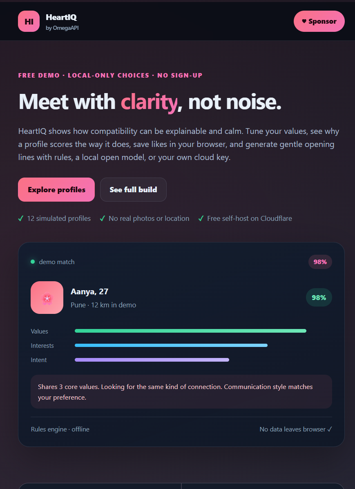
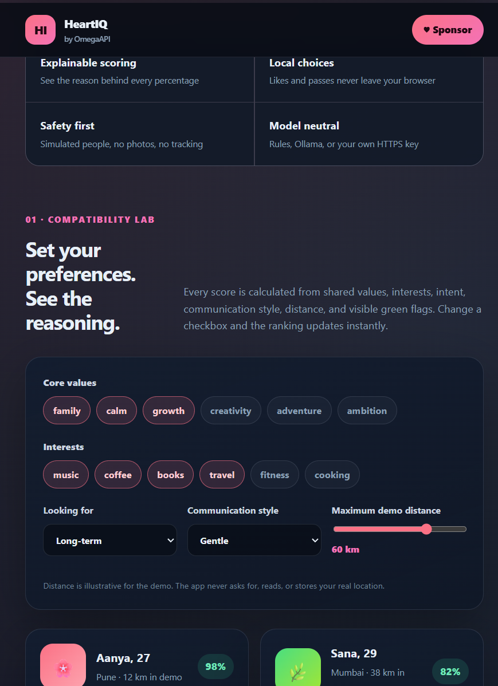
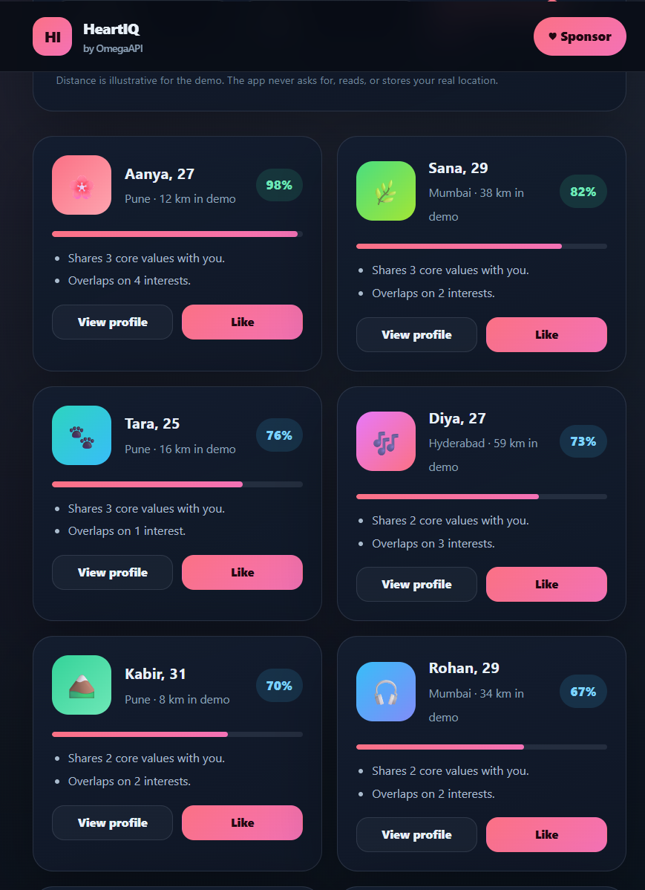
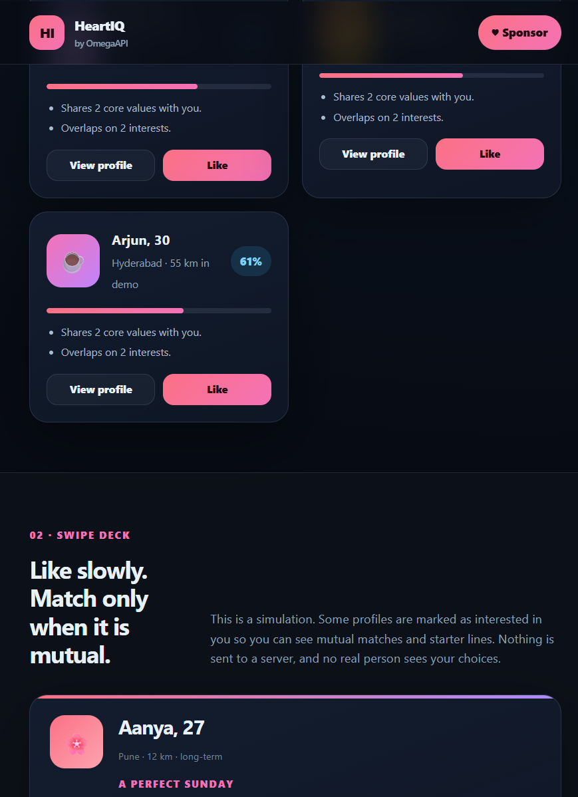

# HeartIQ — Privacy-safe dating compatibility demo

[](https://heartiq-2t8.pages.dev/)
[](LICENSE)

HeartIQ is an open-source dating compatibility demo that explains *why* two profiles score the way they do. It uses twelve simulated people, local-only likes and passes, transparent rules, a localhost-only open-model bridge, and an optional bring-your-own-key cloud adapter.

Built by **Krishna Prakash Ojha (Leon)** at **OmegaAPI** · [omegaapi.com](https://omegaapi.com)

> The public demo is free. The production-shaped full build lives in a private repo and is shared manually with sponsors. There is no card, checkout, or payment code in either app.

---

## What it does

| Area | Feature |
| --- | --- |
| Compatibility lab | Tune values, interests, intent, style, and demo distance. Rankings update instantly. |
| Explainable score | Every percentage is split into values, interests, intent, style, distance, and green flags. |
| Swipe deck | Like or pass on simulated profiles. Choices stay in `localStorage` as profile IDs only. |
| Mutual matches | Selected simulated profiles are marked as interested so the match flow can be demoed safely. |
| Starter lines | Rules generate calm, redacted opening lines. Optional local or BYOK models can rewrite them. |
| Model neutral | Rules work offline. Add Ollama locally or call any public HTTPS OpenAI-compatible endpoint with your own key. |
| Privacy | No real photos, no sign-up, no location request, no email or phone collection, no analytics. |
| Preview lock | A signed three-day cookie keeps the public preview fresh. It stores only a timestamp and a nonce. |

---

## Live demo

**https://heartiq-2t8.pages.dev/**

The public preview issues a signed three-day cookie. It contains no profile choice, IP address, email, phone, or message content.

---

## Three modes

### 1. Public demo — active here

Twelve fictional profiles, browser-only choices, and deterministic scoring. Nothing is sent to a server when you like, pass, or change preferences.

### 2. Full build — sponsor access

The private `heartiq-full` repo contains the production-shaped version: real accounts with signed sessions, D1 tables for profiles and mutual likes, a report queue, admin moderation, retention notes, and a deployment runbook.

Access is manual because the GitHub account is a personal account, not an organization. After sponsoring, email [info@omegaapi.com](mailto:info@omegaapi.com) or message [the OmegaAPI channel](https://t.me/Omegaapiofficial) with your GitHub username. See [docs/SPONSOR-ACCESS.md](docs/SPONSOR-ACCESS.md).

### 3. Model studio — optional

- **Rules engine** — default, offline, no key.
- **Local open model** — run `npm run bridge` with Ollama on `127.0.0.1:8791`.
- **Cloud BYOK** — enter a public HTTPS endpoint, model name, and your own key. The key is used for one request and is never written to D1, logs, source, or browser storage.

Full details are in [docs/MODELS.md](docs/MODELS.md).

---

## Screenshots

| Compatibility lab | Swipe deck |
| --- | --- |
|  |  |

| Model studio | Sponsor access |
| --- | --- |
|  |  |

---

## Project structure

```text
assets/                  Browser UI and styles
bridge/                  Localhost-only Ollama bridge
functions/
  _middleware.js         Signed three-day preview lock
  api/ai/icebreakers.js  Request-only cloud BYOK adapter
lib/
  match.js               Profiles, scoring, redaction, starter lines
  model.js               Prompt builder, endpoint validation, output parsing
docs/                    Deployment, models, sponsor access
screenshots/             Demo screenshots
tests/                   Node test suite
```

---

## Run locally

Requirements: Node.js 20+ and Wrangler 4.

```bash
npm install
cp .dev.vars.example .dev.vars
# Replace the placeholder with a long random string.
npm test
npm run dev
```

Open `http://localhost:8792`.

To use a local model in another terminal:

```bash
ollama pull llama3.2
npm run bridge
```

---

## Deploy your own

1. Create a Cloudflare Pages project named `heartiq` or change the name in `package.json`.
2. Add a `DEMO_TRIAL_SECRET` Pages secret with a long random value.
3. Deploy with `npm run deploy`.

```bash
wrangler pages secret put DEMO_TRIAL_SECRET --project-name heartiq
npm run deploy
```

Full steps are in [docs/DEPLOYMENT.md](docs/DEPLOYMENT.md).

---

## Privacy and safety

- No payment, card, or subscription code.
- No developer phone number or third-party chat button.
- No real photos, real locations, sign-up, or sensitive personal data.
- Likes and passes stay in browser storage as profile IDs.
- Cloud keys are request-only. Private hosts and credentials in URLs are rejected.
- The preview cookie is signed, HttpOnly, SameSite=Lax, and Secure on HTTPS.
- API responses are marked `no-store`, and a strict CSP blocks unapproved origins.

This is a demo template, not a real dating service. Add your own retention policy, consent flow, and data-handling review before collecting real user information.

---

## Tests

```bash
npm test
```

All tests run offline with Node's built-in test runner.

---

## ❤️ Sponsor this project

If HeartIQ helps you learn or build, please consider sponsoring OmegaAPI. It keeps the live demo online and lets me keep building free, open-source tools. Sponsors can also request the private full build.

[](https://github.com/sponsors/omegaapi-india)

Goal: **10 monthly sponsors**. [View monthly tiers ($5, $25, $100, $250)](https://github.com/sponsors/omegaapi-india?interval=monthly). Tiers run from **$5 to $250**. Every monthly sponsor helps. Can't sponsor? A ⭐ on this repo or sharing it with someone who needs it helps too!

## License

MIT — see [LICENSE](LICENSE). Copyright © 2026 Krishna Prakash Ojha (Leon), OmegaAPI.
